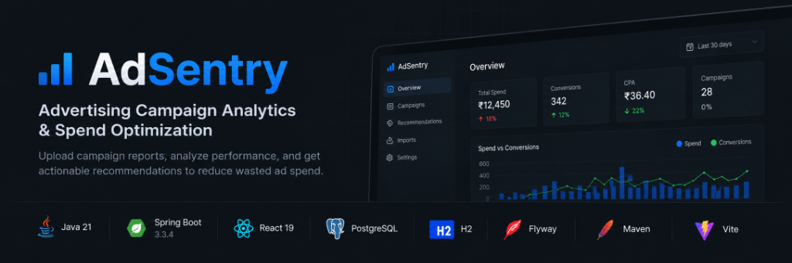

# AdSentry

<p align="center">
  
</p>

<p align="center">
  <strong>Advertising Campaign Analytics &amp; Spend Optimization</strong>
</p>

<p align="center">
  A full-stack analytics platform that turns advertising campaign CSV data into actionable performance insights and rule-based recommendations.
</p>

<p align="center">
  <a href="https://www.oracle.com/java/technologies/downloads/">
    
  </a>
  <a href="https://spring.io/projects/spring-boot">
    
  </a>
  <a href="https://react.dev/">
    
  </a>
  <a href="https://www.postgresql.org/">
    
  </a>
  <a href="https://maven.apache.org/">
    
  </a>
  <a href="https://vite.dev/">
    
  </a>
</p>

---

## Overview

AdSentry helps businesses analyze advertising campaign performance, identify potentially wasted spend, and monitor acquisition costs through a unified analytics dashboard.

Upload campaign reports, calculate key performance metrics, and receive actionable recommendations using a deterministic rule-based engine.

## Features

- **CSV Ingestion** — Import, validate, and normalize campaign reports.
- **Campaign Analytics** — Analyze advertising spend, conversions, and cost per acquisition (CPA).
- **Rule-Based Recommendations** — Flag high-spend campaigns with zero known conversions and campaigns exceeding their CPA target.
- **Configurable Thresholds** — Adapt recommendation rules to campaign goals.
- **Recommendation Management** — Persist recommendations and recalculate them when underlying analysis changes.
- **CSV Export** — Export sanitized reports for further analysis.

## Tech Stack

| Component | Technology |
| :--- | :--- |
| **Backend** | Java 21, Spring Boot 3.3.4 |
| **Frontend** | React 19, Vite |
| **API** | REST |
| **Persistence** | Spring Data JPA, Hibernate |
| **Production database** | PostgreSQL |
| **Local database** | H2 |
| **Schema migrations** | Flyway |
| **Testing** | JUnit, Spring Boot Test, H2 |
| **Build tool** | Maven |

## Architecture

```text
React + Vite
     |
     | REST API
     v
Spring Boot Backend
     |
     +-- CSV Ingestion & Validation
     +-- Campaign Data Management
     +-- Analytics Engine
     +-- Recommendation Engine
     +-- Settings & CSV Export
     |
     v
PostgreSQL / Local H2
     |
     +-- Flyway Schema Migrations
```

## Run Locally

**Prerequisites:** JDK 21, Maven, Node.js, and npm.

### 1. Clone the repository

```bash
git clone https://github.com/thirulokeshh/AdSentry.git
cd AdSentry
```

### 2. Start the backend

Open a terminal in the `backend` directory.

**Windows CMD:**
```cmd
set SPRING_PROFILES_ACTIVE=local
mvn spring-boot:run
```

**macOS / Linux:**
```bash
SPRING_PROFILES_ACTIVE=local mvn spring-boot:run
```

The backend runs at `http://localhost:8080`.

### 3. Start the frontend

Open a second terminal in the `frontend` directory.

```bash
npm install
npm run dev
```

Open the local URL printed by Vite, normally `http://localhost:5173`.

### 4. Verify the backend

Visit `http://localhost:8080/actuator/health`.

A successful response should include:

```json
{ "status": "UP" }
```

> **Local database:** The local profile uses an in-memory H2 database. Data is lost when the backend stops. Production uses PostgreSQL.

## Run Tests

From the `backend` directory:

```bash
mvn test
```

## Repository

[GitHub — AdSentry](https://github.com/thirulokeshh/AdSentry)

---

<p align="center">
  Built with Java, Spring Boot, React, and PostgreSQL.
</p>
